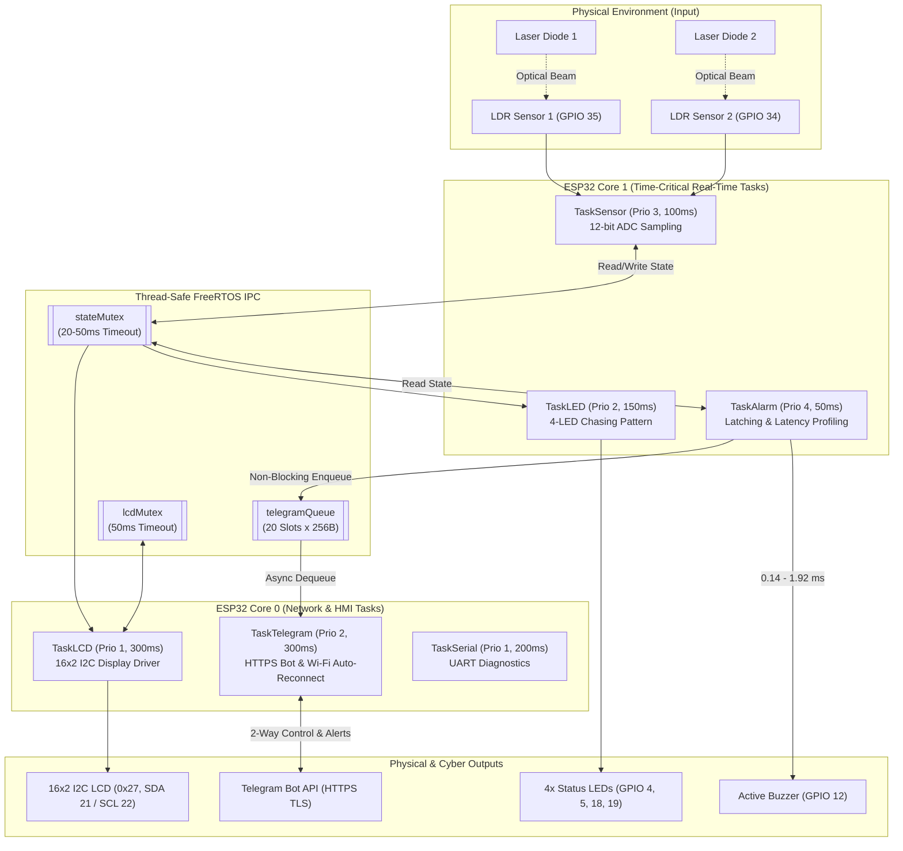

# ESP32 Dual-Core FreeRTOS Laser-Based Home Security System

[](https://www.espressif.com/)
[](https://github.com/espressif/arduino-esp32)
[](https://www.freertos.org/)
[-brightgreen.svg)](#4-reliability-fault-tolerance--low-power-optimization)

A real-time, dual-zone **Cyber-Physical Laser Intrusion Detection & Home Security System** built on the **ESP32-WROOM-32** using **Priority-Based Preemptive FreeRTOS Multitasking**, **Multi-Core Pinning**, **Queue-Decoupled HTTPS Telegram Bot Telemetry**, **Hardware Watchdog Timer (WDT)**, and **ESP-IDF Low-Power Management** (Dynamic Frequency Scaling, Wi-Fi Modem Sleep, and Automatic Light Sleep).

---

## 1. System Overview & Dual-Zone Intrusion Detection Architecture

Traditional single-threaded (`loop()`) IoT security systems suffer from severe blocking delays (1.7 to 4.9 seconds) during synchronous TLS/HTTPS network calls to cloud APIs like Telegram. During those network transactions, the microcontroller freezes—failing to sample sensors or trigger physical alarms when an intruder crosses the perimeter.

This project solves the blocking problem through a **Dual-Core FreeRTOS Architecture**:
- **Dual-Zone Optical Perimeter:** Two continuous laser emitters project beams onto two Light Dependent Resistors (**LDR 1** on `GPIO 35`, **LDR 2** on `GPIO 34`) configured with 12-bit ADC resolution (`0–4095`) and `11 dB` attenuation (`ADC_11db`). When an object interrupts either beam, the voltage divider resistance rises above the calibrated digital threshold (`2800`), immediately flagging an intrusion event.
- **Deterministic Core Isolation:** Hard real-time tasks (sensor acquisition, alarm actuation with latching logic, and chasing LED visual indicators) are pinned exclusively to **Core 1**, completely isolated from high-latency TLS/HTTPS Telegram polling, I2C LCD rendering, and Serial I/O pinned to **Core 0**.
- **Alarm Latching Mechanism:** Once triggered, the system latches `alarmActive = true` and `alarmLatch = true` so that even if a fast-moving intruder quickly passes through the laser beam, the physical siren and visual chase pattern remain active until explicitly acknowledged by an authorized administrator via Telegram (`/silentalarm` or `/matialarm`).



---

## 2. Hardware Pinout Table

| Component | ESP32 Pin | Mode / Interface | Description |
| :--- | :--- | :--- | :--- |
| **LDR Sensor 1** | `GPIO 35` (`ADC1_CH7`) | Analog Input (12-bit ADC, `ADC_11db`) | Primary laser beam intensity detector (Threshold: `2800`) |
| **LDR Sensor 2** | `GPIO 34` (`ADC1_CH6`) | Analog Input (12-bit ADC, `ADC_11db`) | Secondary laser beam intensity detector (Threshold: `2800`) |
| **Laser Diode 1 & 2** | `5V / 3.3V & GND` | Continuous Optical Emitter | Dual-zone laser emitters aimed at LDR 1 & LDR 2 |
| **Active Buzzer** | `GPIO 12` | Digital Output (`HIGH` = ON) | High-decibel audio intrusion alarm siren |
| **Alert LED 1** | `GPIO 4` | Digital Output (via 220Ω resistor) | Chasing visual indicator LED #1 |
| **Alert LED 2** | `GPIO 5` | Digital Output (via 220Ω resistor) | Chasing visual indicator LED #2 |
| **Alert LED 3** | `GPIO 18` | Digital Output (via 220Ω resistor) | Chasing visual indicator LED #3 |
| **Alert LED 4** | `GPIO 19` | Digital Output (via 220Ω resistor) | Chasing visual indicator LED #4 |
| **16x2 I2C LCD (SDA)** | `GPIO 21` | I2C Data (`0x27`) | Real-time status (`Normal`, `INTRUDER`, `MUTED`) & ADC readout |
| **16x2 I2C LCD (SCL)** | `GPIO 22` | I2C Clock (`0x27`) | I2C clock signal for 16x2 LCD display |

---

## 3. Dual-Core FreeRTOS Task Allocation

Tasks are created and pinned using `xTaskCreatePinnedToCore()` under FreeRTOS Priority-Based Preemptive Scheduling with Time Slicing:

| Task Name | Core | Priority | Stack Size (Bytes) | Period (`vTaskDelay`) | WDT Monitored | Responsibility |
| :--- | :---: | :---: | :---: | :---: | :---: | :--- |
| **`TaskAlarm`** | **Core 1** | **4** *(Highest)* | `4096` | `50 ms` (20 Hz) | Yes | Evaluates sensor triggers, drives `buzzer`, manages `alarmLatch`, measures microsecond trigger-to-buzzer latency, and pushes alerts to `telegramQueue`. |
| **`TaskSensor`** | **Core 1** | **3** | `4096` | `100 ms` (10 Hz) | Yes | Samples 12-bit ADC channels (`GPIO 35`, `34`), compares against `threshold (2800)`, captures `triggerTime = micros()`, and updates shared state. |
| **`TaskLED`** | **Core 1** | **2** | `2048` | `150 ms` (~6.7 Hz) | Yes | Executes a non-blocking 4-LED chasing/running animation on `GPIO 4, 5, 18, 19` during active intrusion states. |
| **`TaskTelegram`** | **Core 0** | **2** | `8192` | `300 ms` (~3.3 Hz) | Yes | Dequeues outbound alerts from `telegramQueue`, polls incoming Telegram commands over TLS (`WiFiClientSecure`), and manages `reconnectWiFiIfNeeded()`. |
| **`TaskLCD`** | **Core 0** | **1** | `4096` | `300 ms` (~3.3 Hz) | Yes | Thread-safely updates the 16x2 I2C LCD (`0x27`) with system state on Row 0 and live formatted ADC values (`S1:xxxx S2:xxxx`) on Row 1. |
| **`TaskSerial`** | **Core 0** | **1** *(Lowest)* | `2048` | `200 ms` (5 Hz) | No | Handles non-critical UART input buffer flushing and serial diagnostics. |

---

## 4. Reliability, Fault Tolerance & Low-Power Optimization

### Queue-Based Asynchronous Decoupling (`telegramQueue`)
- `telegramQueue = xQueueCreate(20, sizeof(TelegramMsg_t))` buffers up to **20 messages** (256 bytes each).
- When an intrusion occurs, `TaskAlarm` on Core 1 enqueues the alert string in `< 50 ms` (`xQueueSend`) and immediately resumes monitoring. `TaskTelegram` on Core 0 drains the queue asynchronously over HTTPS without ever stalling sensor or siren execution.

### Bounded-Timeout Mutex Synchronization (`stateMutex` & `lcdMutex`)
- Shared state variables (`ldrValue1`, `ldrValue2`, `alarm1`, `alarm2`, `alarmActive`, `buzzerMuted`, `alarmLatch`, `alarmCount`) are protected by `stateMutex`, while I2C bus transactions are serialized by `lcdMutex`.
- Every lock acquisition uses a **bounded timeout** (`pdMS_TO_TICKS(20)` to `pdMS_TO_TICKS(50)`) with graceful fallback/retry rather than `portMAX_DELAY`, preventing priority inversion and permanent deadlocks.

### Hardware Task Watchdog Timer (`esp_task_wdt`)
- Configured with a **20-second timeout** (`.timeout_ms = 20000`, `.trigger_panic = true`).
- `TaskSensor`, `TaskAlarm`, `TaskLED`, `TaskLCD`, and `TaskTelegram` register via `esp_task_wdt_add(NULL)` and feed the watchdog every cycle (`esp_task_wdt_reset()`). If any task hangs due to a network or bus anomaly, the ESP32 automatically panics and reboots into a known-good state.
- Automatic Wi-Fi recovery (`reconnectWiFiIfNeeded()`) retries up to 40 times (500 ms intervals) using `vTaskDelay` if the station link drops.

### ESP-IDF Low-Power Management (`initLowPower()`)
1. **Dynamic Frequency Scaling (DFS):** Automatically scales CPU clock between **80 MHz** (idle/normal monitoring) and **240 MHz** (active processing/intrusion) based on $E \propto f^2$.
2. **Wi-Fi Modem Sleep (`WIFI_PS_MIN_MODEM`):** Powers down the Wi-Fi RF transceiver between DTIM beacon intervals when no Telegram packets are being transmitted.
3. **Automatic CPU Light Sleep (`.light_sleep_enable = true`):** Puts CPU cores into light sleep across FreeRTOS `vTaskDelay()` blocked intervals.

---

## 5. Quantitative Benchmark Results

### Power Consumption Benchmark (at 10V Reference Supply)
| Configuration | Voltage (V) | Current (A) | Power (W) | Efficiency Gain |
| :--- | :---: | :---: | :---: | :---: |
| **Without Low-Power / Non-RTOS (Super-loop Polling)** | 10.0 V | 0.08 A (80 mA) | **0.80 W** | Baseline |
| **With FreeRTOS + Low-Power Mode (DFS + Modem/Light Sleep)** | 10.0 V | 0.06 A (60 mA) | **0.60 W** | **25.0% Power Reduction** |

### Latency & Real-Time Response Benchmark
| Metric | Measured Value | Notes |
| :--- | :---: | :--- |
| **Hardware Sensor-to-Buzzer Latency (Dual-Core Decoupled)** | **0.14 ms – 1.92 ms** (`137 µs – 1925 µs`) | Near-instantaneous physical alarm response on Core 1 |
| **Single-Core / Non-Decoupled Wake Latency** | **49.83 ms – 49.90 ms** (`49,834 µs – 49,897 µs`) | ~26x–350x slower when sharing core with Wi-Fi wake/network overhead |
| **Telegram Cloud Notification Delay (HTTPS TLS)** | **1,787 ms – 4,902 ms** (`1.79 s – 4.90 s`) | Fully absorbed by `telegramQueue` on Core 0; zero impact on Core 1 |
| **Object Intrusion Detection Accuracy (1 cm – 7 cm)** | **100% (7/7 distances)** | Tested across 1 cm, 2 cm, 3 cm, 4 cm, 5 cm, 6 cm, and 7 cm beam offsets |

---

## 6. Two-Way Telegram Bot Commands

Authorized users (verified against `CHAT_ID`; unauthorized senders receive `"Unauthorized"`) can remotely monitor and control the security system via Telegram:

| Command | Action & State Transition | Bot Response |
| :--- | :--- | :--- |
| `/status` | Queries live system state (`alarmActive`, `buzzerMuted`, and ADC `threshold`). | `Alarm: ON/OFF`<br>`Muted: YES/NO`<br>`Threshold: 2800` |
| `/silentalarm` | Clears `alarmActive` and `alarmLatch` and silences the buzzer, while keeping the laser security system armed (re-triggers immediately if the beam is still obstructed). | `"Alarm di-silent, sistem tetap aktif..."` |
| `/matialarm` | Completely disarms/mutes the alarm system (`buzzerMuted = true`, `alarmActive = false`, `alarmLatch = false`, buzzer `LOW`). | `"Sistem alarm dimatikan total"` |
| `/nyalaalarm` | Re-arms the alarm system (`buzzerMuted = false`) and returns to active monitoring. | `"Sistem alarm diaktifkan"` |

---

## 7. Repository Structure & Setup

```text
02-esp32-freertos-laser-security/
├── include/
│   └── secrets.example.h          # Template header for Wi-Fi & Telegram Bot credentials
├── src/
│   └── LaserSecurity_FreeRTOS.ino # Complete ESP32 FreeRTOS v7 Final + Low Power firmware
├── .env.example                   # Environment variable template
└── README.md                      # System documentation & benchmarks
```

### Quick Start
1. **Install Required Libraries** in Arduino IDE or PlatformIO:
   - `LiquidCrystal I2C` by Frank de Brabander
   - `UniversalTelegramBot` by Brian Lough
   - `ArduinoJson` by Benoit Blanchon
2. **Configure Credentials:**
   - Copy `include/secrets.example.h` to `src/secrets.h` (or update the macros in `src/LaserSecurity_FreeRTOS.ino`) with your `WIFI_SSID`, `WIFI_PASSWORD`, `BOT_TOKEN`, and `CHAT_ID`.
3. **Flash to ESP32:**
   - Select board **ESP32 Dev Module** (`ESP32-WROOM-32`), set baud rate to `115200`, and upload `src/LaserSecurity_FreeRTOS.ino`.

---

## Authors
**Computer Engineering (Teknik Komputer) — Universitas Brawijaya (2026)**
- Boyjes Sam Domu Situngkir (`245150300111040`)
- Afifah Zuriah Mindarini (`245150301111001`)
- Sheindy Afrilia Manurung (`245150307111005`)
- Faaza Fauzan Adzim (`245150307111010`)
- Adinda Eka Suja Pertiwi (`245150307111014`)
- **Course Instructor:** Eko Setiawan, S.T., M.T., M.Eng., Ph.D.
